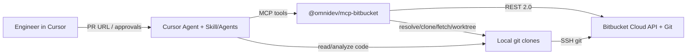

# Architecture

## 1. System context



## 2. Logical components


### A. Review orchestrator

Coordinates URL parse → context gather → (optional) specialist pass → validate/dedupe → approval report → publish.

Do **not** always fan out to specialists. Delegate only when the user asks or the diff clearly warrants it.

### B. Skill

Canonical: `skills/omnidev-review/`. Install under `~/.cursor/skills/` for cross-repo use. Methodology and constraints only — **no secrets**.

### C. Specialized agents (optional)

| Agent | When |
|---|---|
| `sql-reviewer` | SQL/ORM/migrations/indexes/transactions |
| `security-reviewer` | Authn/authz, injection, secrets, IDOR |
| `performance-reviewer` | N+1, hot loops, unsafe concurrency |
| `regression-reviewer` | Shared helpers, contracts, workers/retries |

### D. MCP / libraries

Independently testable TypeScript modules. MCP is a thin façade over:

- `bitbucket/` — HTTP + PR/comment operations  
- `publishing/` — diff parse, anchors, publish batching  
- `repository/` — local discovery, clone, git safety  
- `schemas/` — Zod contracts  
- `utils/` — config, logging, redaction  

## 3. Package layout

```text
packages/mcp-bitbucket/
├── bin/run-mcp.sh
├── config/review-guidelines.md
├── src/
│   ├── mcp/server.ts
│   ├── cli.ts
│   ├── bitbucket/
│   ├── repository/
│   ├── publishing/
│   ├── schemas/
│   └── utils/
└── tests/
```

Skills live under repo-root `skills/omnidev-review/`.

## 4. Finding model

Findings use a structured schema (`id`, severity, confidence, path/line, evidence, `publishable`, …). Inline Bitbucket comments use `to` / `from` on diff hunks only — never invent anchors on unchanged lines outside the diff.

## 5. Runtime topology

1. Cursor starts `bin/run-mcp.sh`  
2. Script resolves package root, ensures `dist/` (+ core) exist  
3. Server speaks MCP over stdio  
4. Agent calls tools; libraries talk to `https://api.bitbucket.org/2.0`  
5. Diff endpoints may 302; client follows redirects  

## 6. Failure handling

| Failure | Behavior |
|---|---|
| 429 / 5xx | Exponential backoff retries |
| Invalid anchor | Reject publish; report unanchorable |
| Duplicate comment body+path+line | Skip |
| Ambiguous network after POST | Re-list comments before blind retry |
| Missing local repo | Clone to `BITBUCKET_REVIEW_WORKSPACE` via SSH |
| Dirty local tree | Leave alone; use worktree when needed |
