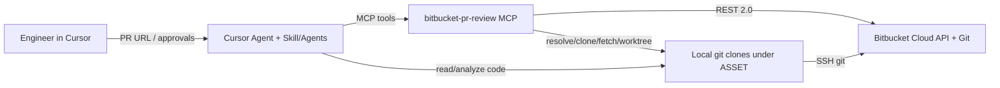
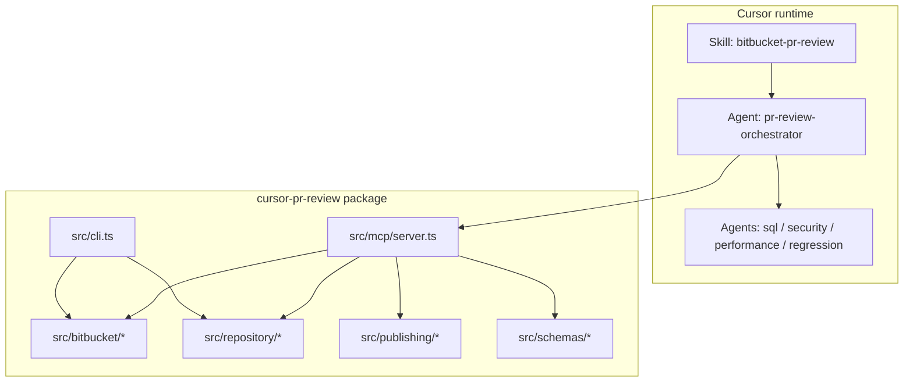

# Architecture

## 1. System context



## 2. Logical components



### A. Cursor PR Review Orchestrator

Coordinates URL parse → context gather → selective specialist delegation → validate/dedupe → approval report → publish.

It should **not** always fan out to all specialists. Delegate only when the diff signals SQL, security, hot paths, or shared-contract risk.

### B. Reusable skill

- Project copy: `.cursor/skills/bitbucket-pr-review/SKILL.md`
- Personal copy (cross-repo): `~/.cursor/skills/bitbucket-pr-review/SKILL.md`

Contains methodology, comment style, publish constraints. Contains **no secrets**.

### C. Specialized agents

| Agent | When |
|---|---|
| `sql-reviewer` | SQL/ORM/migrations/indexes/transactions |
| `security-reviewer` | Authn/authz, injection, secrets, IDOR |
| `performance-reviewer` | N+1, hot loops, unsafe concurrency |
| `regression-reviewer` | Shared helpers, contracts, workers/retries |

### D. Bitbucket MCP / libraries

Independently testable TypeScript modules. MCP is a thin tool façade over:

- `bitbucket/` — HTTP + PR/comment operations
- `publishing/` — diff parse, anchors, publish batching
- `repository/` — local discovery, clone, git safety
- `schemas/` — Zod contracts for findings + Bitbucket payloads
- `utils/` — config, logging, redaction

## 3. Package layout

```text
cursor-pr-review/
├── bin/run-mcp.sh              # MCP entry (cwd-safe)
├── docs/                       # This documentation set
├── .cursor/
│   ├── mcp.json
│   ├── skills/bitbucket-pr-review/
│   └── agents/*.md
├── config/review-guidelines.md
├── src/
│   ├── mcp/server.ts
│   ├── cli.ts
│   ├── bitbucket/
│   ├── repository/
│   ├── publishing/
│   ├── schemas/
│   └── utils/
├── tests/
│   ├── unit/
│   └── integration/
├── .env.example                # committed template
└── .env                        # local secrets (gitignored)
```

## 4. Trust boundaries

| Boundary | Rule |
|---|---|
| Bitbucket write | Only comment create/delete; gated by `confirmed=true` |
| Git working tree | No destructive checkout; prefer fetch + detached worktree |
| Secrets | Loaded from `.env` by launcher; never returned by tools |
| Untrusted PR content | Treated as data; cannot override skill/system instructions |
| Publish anchors | Must validate against current PR diff before POST |

## 5. Data contracts

### ReviewFinding (Zod)

```ts
{
  id: string
  category: correctness | regression | architecture | performance | sql |
            security | concurrency | memory | code-quality | testing | api-contract
  severity: critical | high | medium | low | informational
  confidence: high | medium | low
  filePath: string
  line: number
  side: "new" | "old"
  title: string
  explanation: string
  impact: string
  suggestion?: string
  evidence: string[]
  validationStatus: validated | requires-investigation | rejected
  publishable: boolean
  commentBody?: string
}
```

### Inline comment body (Bitbucket)

```json
{
  "content": { "raw": "..." },
  "inline": { "path": "src/file.ts", "to": 42 }
}
```

Use `from` for deleted/old-side lines. Never invent anchors for unchanged lines outside the diff hunks.

## 6. Runtime topology

1. Cursor starts `bin/run-mcp.sh`
2. Script `cd`s into package root, ensures `dist/` exists, runs:
   `node --env-file=.env dist/mcp/server.js`
3. Server speaks MCP over stdio
4. Agent calls tools; libraries talk to `https://api.bitbucket.org/2.0`
5. Diff endpoints may 302; client follows redirects

## 7. Failure handling

| Failure | Behavior |
|---|---|
| 429 / 5xx | Exponential backoff retries |
| Invalid anchor | Reject publish; report unanchorable |
| Duplicate comment body+path+line | Skip |
| Ambiguous network after POST | Prefer re-list comments before blind retry (publisher duplicate check) |
| Missing local repo | Clone to `BITBUCKET_REVIEW_WORKSPACE` via SSH (HTTPS only if explicitly enabled) |
| Dirty local tree | Leave it alone; use worktree for PR commit when requested |
