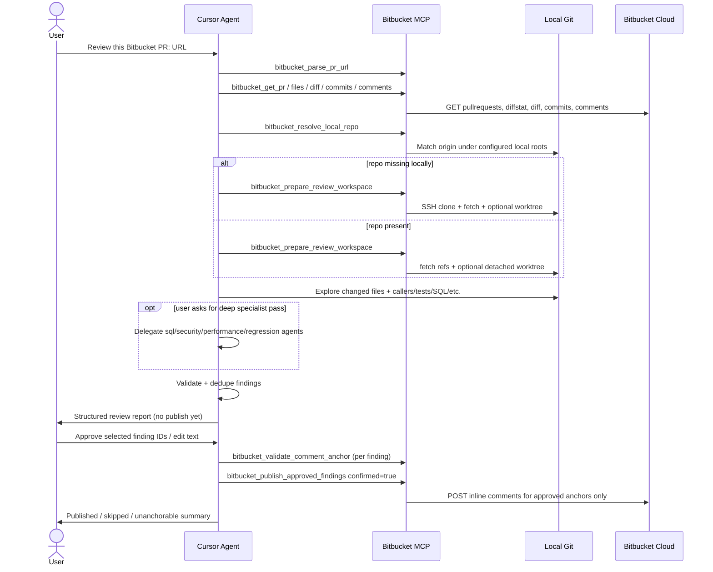
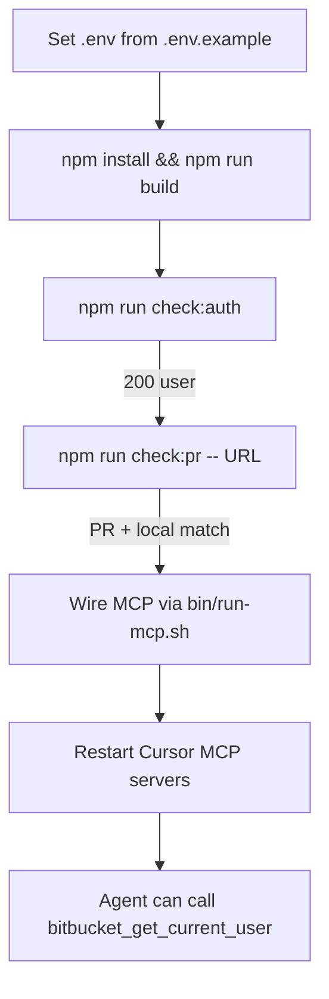
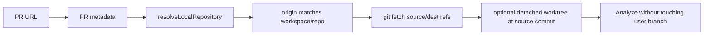
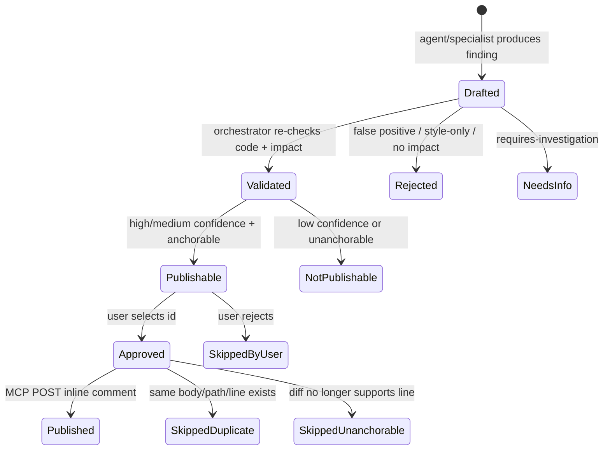
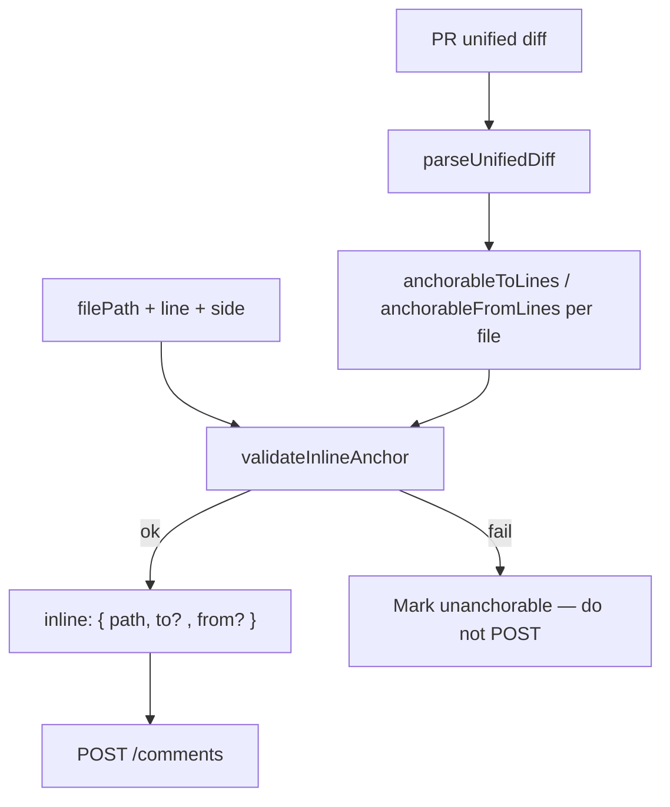

# End-to-end flows

## 1. Happy path — review + approve + publish



## 2. Connectivity / setup verification



## 3. Repository access modes

### Mode A — existing local clone



Rules:

- Do not assume current branch is the PR source branch  
- Do not overwrite uncommitted changes  
- Prefer worktree / read-only inspection  

### Mode B — clone into managed workspace

```mermaid
flowchart LR
  Miss[No local match] --> Clone[ensureReviewClone]
  Clone --> SSH[git@bitbucket.org:ws/repo.git]
  SSH -->|fail and ALLOW_HTTPS=1| HTTPS[HTTPS clone then scrub token from remote URL]
  SSH --> Fetch[fetch PR commits/branches]
  HTTPS --> Fetch
```

Default clone root: `BITBUCKET_REVIEW_WORKSPACE` (default `~/.omnidev/review-workspaces`).

## 4. Finding lifecycle



## 5. Inline anchor mapping



- `to` = line on the **new** file side  
- `from` = line on the **old** file side  
- Added files: `to` only; deleted: `from` only  

## 6. Approval gate (mandatory)

```text
PR REVIEW COMPLETE
Repository: {repo}
PR: #{id}
Files reviewed: N
Findings: N

Proposed inline comments:
1. HIGH  path:line  short title
...

Publish which? all | ids... | none
```

Only after the user answers does the agent call publish tools with `confirmed=true`.

## 7. Anti-patterns blocked by design

| Anti-pattern | Control |
|---|---|
| Auto-comment on fetch | No publish without `confirmed` |
| Comment on wrong line | Anchor validator |
| Duplicate spam | Exact content + path/line duplicate check |
| Approve/merge via token | Prefer scopes without `write:pullrequest` |
| Token in skill files | Skills contain process only |
| Checkout over dirty work | Worktree / fetch-only helpers |
| Blind `tsx` from `$HOME` | `bin/run-mcp.sh` + `dist/` |
